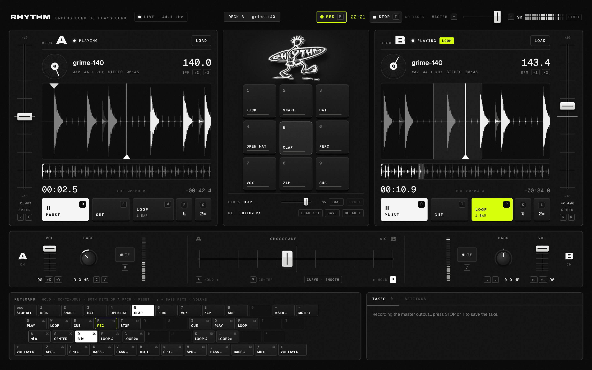

# RHYTHM — underground DJ playground

**Less menus. More mixing. The keyboard is the controller.**

RHYTHM is a minimalist virtual DJ controller that runs in the browser: two decks, a nine-pad
drum sampler, a crossfader and a master recorder, all playable from a Mac keyboard.
Load two tracks, press a few keys, drop kicks and snares on top, record the mix and download it.



## Run it

```bash
npm install
npm run dev        # http://localhost:5173
```

```bash
npm run build      # type-check + production build into dist/
npm run preview    # serve the build on http://localhost:4173
npm test           # unit tests (Vitest)
npm run test:e2e   # end-to-end audio checks in headless Chromium (needs Playwright, see below)
```

Browsers only start audio after a user gesture: click anywhere or press any key once.
The header shows `LIVE · 48.0 kHz` when the engine is running.

## Keyboard

Keys are bound by **physical position** (`KeyboardEvent.code`), so the layout works on any
keyboard language. The legend at the bottom of the screen lights up every key you hold.

| Left hand — Deck A |                          | Right hand — Deck B |                          |
| ------------------ | ------------------------ | ------------------- | ------------------------ |
| `Q`                | Play / pause             | `O`                 | Play / pause             |
| `E`                | Cue (hold to preview)    | `I`                 | Cue (hold to preview)    |
| `W`                | Loop on / off            | `P`                 | Loop on / off            |
| `F` / `G`          | Loop size ½ / 2×         | `K` / `L`           | Loop size ½ / 2×         |
| `Z` / `X`          | Speed − / + (hold)       | `N` / `M`           | Speed − / + (hold)       |
| `C` / `V`          | Bass − / + (hold)        | `,` / `.`           | Bass − / + (hold)        |
| `⇧C` / `⇧V`        | Volume − / + (hold)      | `⇧,` / `⇧.`         | Volume − / + (hold)      |
| `B`                | Mute                     | `/`                 | Mute                     |

| Mixer & global |                                                   |
| -------------- | ------------------------------------------------- |
| `A` / `D`      | Crossfader toward A / B — moves while held        |
| `S`            | Crossfader back to center                         |
| `1` … `9`      | Drum pads 1–9 (numpad works too)                  |
| `R` / `T`      | Start / stop recording                            |
| `−` / `=`      | Master volume (hold)                              |
| `Esc`          | Emergency stop: cuts both decks and every pad     |

How the keys behave:

- **Continuous controls** (crossfader, speed, bass, volume, master) behave like physical
  faders: a tap moves one fine step, holding keeps moving and accelerates, releasing stops.
  They are animated per frame from `keydown`/`keyup`; OS auto-repeat is ignored.
- **Both keys of a pair** (`Z`+`X`, `C`+`V`, …) reset that control to neutral.
- **Shift is the layer key**, like a SHIFT button on a controller: Shift + the bass keys
  controls deck volume.
- Shortcuts are ignored while typing in a text field (e.g. the BPM field), `⌘` / `Ctrl` /
  `Alt` combinations are always left to macOS and the browser, and every held key is
  released when the window loses focus — nothing gets stuck.
- Bindings are plain data (`src/state/keymap.ts`), ready for a remapping UI.

## What it does

### Decks
- Load MP3, WAV, OGG, M4A/AAC, FLAC or AIFF (whatever the browser decodes) with **LOAD** or by
  dropping a file on the deck. Each deck loads independently; the other keeps playing.
- Scrolling close-up waveform (low frequencies drawn in white, so kicks stand out) and a
  whole-track overview that doubles as the progress bar: click or drag it to seek.
- Elapsed / remaining time, a platter that turns with the real playhead, auto-cue at the
  first audible sound.
- **Speed** fader on the outer edge (±8 / ±16 / ±50 %). In v1 pitch and speed are linked,
  like a turntable (the engine keeps a single playback abstraction so a key-lock
  time-stretcher can be added later).
- **Tempo** is estimated on load and shown with the speed applied. Click the value to type
  it, or use /2 / ×2. RHYTHM does **not** sync or beat-match decks — the BPM is
  information and the base for loop lengths, nothing more.

### CUE (CDJ style)
- Paused: `E` sets the cue point at the current position and plays while held; release
  returns to the cue point. Press `Q` while holding `E` to keep playing.
- Playing: `E` jumps back to the cue point and pauses.

### Loops
- `W` loops from what you hear right now, with the selected size: ¼, ½, 1 or 2 beats,
  1, 2 or 4 bars. `F` / `G` halve or double the size, live, keeping the phase (the classic
  roll build-up). `W` again exits and playback continues.
- With a tempo, loop lengths come from the BPM; without one they are time-based
  (1 beat = 0.5 s).
- Loops use the native sample-accurate looping of `AudioBufferSourceNode`, with loop points
  snapped to rising zero crossings to keep the seam click-free.

### Drum pad
- Nine pads with a built-in kit synthesized at startup (KICK, SNARE, HAT, OPEN HAT, CLAP,
  PERC, VOX, ZAP, SUB), so every pad plays from the first second. The closed hat chokes the
  open hat.
- Replace a pad by dropping a file on it, right-clicking it, or **LOAD** in the pad strip.
  **LOAD KIT** takes up to nine files at once (assigned in file-name order) or a kit file.
- Per-pad volume, unlimited overlapping hits, instant triggering (samples are decoded up
  front).
- Your kit is saved in the browser (IndexedDB) and comes back next time. **SAVE** exports
  it as a `.json` kit file (samples embedded) to share or reload later; **DEFAULT**
  restores the built-in kit.

### Mixer
- Per deck: volume fader, bass knob (low shelf at 160 Hz, −26 dB kill to +6 dB), mute and a
  level meter. Master volume and stereo meter in the header.
- Crossfader curves: **SMOOTH** (constant power) or **CUT** (both channels open until the
  edges, for cuts). Key speed of the crossfader is configurable in Settings.
- A safety limiter on the master bus prevents clipping when decks and pads pile up
  (the `LIMIT` lamp lights when it works).

### Recording
- `R` records the **final master output** — both decks after their faders, EQ and
  crossfader, plus the pads — exactly what you hear. `T` stops.
- Takes stay in the TAKES panel for the session: play them back, download the original
  (WebM/Opus in Chrome and Firefox, MP4/AAC in Safari) or export a 16-bit **WAV**.
- The page warns before closing if a take hasn't been downloaded.

### Logo
The supplied RHYTHM artwork is rendered as a small extruded white object (stacked masked
layers in CSS 3D). Grab it and drag horizontally to spin it; it coasts with inertia, slows
down and settles facing front. With music playing it leans in very slightly on the low end
(switch off under Settings → LOGO MOTION).

## Architecture

```
Deck A voices → volume → bass (low shelf) → mute → crossfade A ┐
Deck B voices → volume → bass (low shelf) → mute → crossfade B ┼→ mix bus → master → limiter ┬→ speakers
Pads → pad gain → sampler bus ─────────────────────────────────┘                            ├→ MediaRecorder
                                                                                             └→ meters
```

```
src/
  audio/                 Web Audio engine — no React in here
    AudioEngine.ts       context, graph, mixer, kit, recording, app store
    DeckPlayer.ts        one deck: voices, CUE, loops, rate, EQ, mute
    transport.ts         pure playhead math (unit tested)
    Sampler.ts           nine one-shot pads, choke groups
    defaultKit.ts        built-in kit, synthesized with OfflineAudioContext
    Recorder.ts          MediaRecorder on the master bus, WAV export
    analysis.ts          waveform peaks, tempo detection, zero-crossing snap, auto-cue
    crossfade.ts / wav.ts / constants.ts / types.ts
  state/
    KeyboardController.ts  keydown/keyup → actions, continuous controls, pressed keys
    keymap.ts              bindings as data
    store.ts               tiny external store (useSyncExternalStore)
    kitStorage.ts / settings.ts   IndexedDB kit + localStorage settings
  components/            Deck, Waveform, DrumPad, Mixer, Logo3D, Header, KeyLegend, SidePanel, controls/
  hooks/                 shared animation frame loop, keyboard layout labels
```

Discrete state (loaded tracks, rates, loops, pads, takes…) flows through the store into
React. Anything that moves every frame (playheads, waveforms, meters, platters, the logo)
is drawn from a single shared `requestAnimationFrame` loop that reads the audio clock
directly, without React renders.

React 19, TypeScript, Vite. No runtime dependencies besides React and self-hosted fonts
(Archivo, Geist, Geist Mono).

## Testing

- `npm test` — unit tests for the playhead/loop math, crossfade curves, loop lengths, WAV
  encoding, waveform peaks, zero-crossing snapping and tempo detection across house, UKG,
  grime, breaks, jungle, DnB and hip-hop grooves (plus no false tempo on tones/noise/silence).
- `npm run test:e2e` — drives the built app in headless Chromium with the real keyboard and
  checks the **audio**, using an FFT on the master bus and by decoding recorded takes:
  both decks play at once; the crossfader moves while A/D is held, stops on release and fully
  isolates each deck; speed changes the actual pitch and playhead rate; bass cuts the low end
  without touching mids; volume and mute act on the signal; loops wrap and resize; CUE
  previews and returns; nine pads play simultaneously; custom samples load and persist; a
  recording contains the real crossfade; WAV export is valid; tempo is detected; typing,
  ⌘-shortcuts, key repeat and window blur are handled. Requires Playwright:
  `npm i -D playwright && npx playwright install chromium`.

Tested in Chromium. Built on standard Web Audio, MediaRecorder and CSS features that Chrome,
Firefox and Safari support on macOS.

## Not in v1 (on purpose)

- **Beat sync / beat-matching** and **key lock** (time-stretch without pitch change) are not
  implemented, and the UI doesn't pretend otherwise.
- **YouTube links.** RHYTHM will not extract audio from YouTube — that is against YouTube's
  terms. The official IFrame Player API can play a video inside the page, but its audio
  stays in a cross-origin player: it cannot be routed into Web Audio, so it could not be
  crossfaded, EQ'd, looped or recorded. A YouTube deck would therefore be a playback-only
  side player at best. Local files stay the core.
- Key remapping UI, MIDI controllers (Web MIDI) and multi-track stems are natural next steps.

---

Logo artwork supplied by the RHYTHM project. Original references in `design/references/`.
